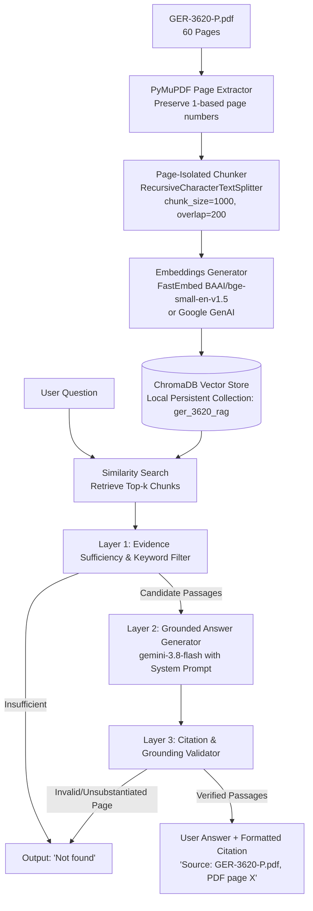

# PDF-Based RAG System: Heavy-Duty Gas Turbine Operating & Maintenance Considerations (GER-3620P)

A strictly grounded Retrieval-Augmented Generation (RAG) question-answering system built in Python using **LangChain**, **ChromaDB**, and **Google Gemini (gemini-3.8-flash)**, grounded exclusively in GE Vernova's official technical specification document:
**GER-3620P (Rev P, 2021/03/15): *Heavy-Duty Gas Turbine Operating and Maintenance Considerations***.

---

## 1. Project Objective & Core Guarantees

The goal of this system is to provide accurate, evidence-backed answers to operator and engineer questions regarding gas turbine maintenance intervals, operating factors, inspection scopes, and parts planning.

### Strict Grounding & `Not found` Policy
1. **Single Source of Truth:** Answers are drawn exclusively from the indexed 60-page PDF document. No outside memory, web knowledge, or unverified assumptions are permitted.
2. **Deterministic Abstention:** If a question cannot be answered completely, unambiguously, and with direct textual proof from the document, the system outputs **exactly `Not found`** (no explanations, no caveats, no extra punctuation).
3. **Verified Page Citations:** Every supported answer includes a validated citation pointing to the exact 1-based PDF page number (e.g., `Source: GER-3620-P.pdf, PDF page 10`). Unverified or out-of-bounds citations are automatically rejected.

---

## 2. Architecture & Pipeline



---

## 3. Project Directory Structure

```text
GENAI EXAM/
├── app.py                     # Interactive Streamlit application
├── ingest.py                  # Document ingestion & ChromaDB indexing pipeline
├── config.py                  # Central configuration & parameters
├── requirements.txt           # Pinned project dependencies
├── .env.example               # Environment variables template
├── .env                       # Local API credentials (git-ignored)
├── .gitignore                 # Excludes secrets, caches, and vector DB
├── README.md                  # Complete documentation and evaluation report
├── data/
│   ├── GER-3620-P.pdf         # Verified source document (60 pages, 5.36 MB)
│   └── pdf_hash.json          # Ingestion checksum & status tracker
├── chroma_db/                 # Persistent local ChromaDB collection
├── src/
│   ├── __init__.py
│   ├── pdf_loader.py          # PyMuPDF page-by-page extractor
│   ├── chunking.py            # Page-boundary isolated text splitter
│   ├── embeddings.py          # FastEmbed, Gemini, and Mock embedding factory
│   ├── retriever.py           # Chroma vector store manager & query engine
│   ├── evidence_validator.py  # Layered evidence sufficiency check
│   ├── citation_validator.py  # Page number & content substantiate verifier
│   └── answer_generator.py    # Grounded generation with strict prompt
└── tests/
    ├── __init__.py
    ├── test_pdf_loader.py     # PDF extraction & page structure tests
    ├── test_retrieval.py      # Persistence & empty retrieval tests
    ├── test_citations.py      # Boundary & false citation rejection tests
    ├── test_answerability.py  # Abstention & 'Not found' policy tests
    └── test_end_to_end.py     # Complete pipeline integration tests
```

---

## 4. Setup and Installation

### Prerequisites
- macOS / Linux / Windows
- Python 3.11 or 3.12 (recommended: Python 3.12)
- UV or pip package manager

### Step 1: Environment Setup
```bash
# macOS/Linux
python3 -m venv .venv
source .venv/bin/activate
python -m pip install --upgrade pip
python -m pip install -r requirements.txt
```

### Step 2: Environment Configuration
Copy the template and add your Gemini API key:
```bash
cp .env.example .env
```
Edit `.env`:
```ini
GEMINI_API_KEY=your_gemini_api_key_here
GOOGLE_API_KEY=your_gemini_api_key_here
EMBEDDING_PROVIDER=fastembed
```

### Step 3: Run Ingestion
To extract and index the PDF into local ChromaDB:
```bash
python ingest.py --force
```
Output:
```text
[INFO] PDF verified: GER-3620-P.pdf (60 pages, 5359919 bytes)
[INFO] Extracted 60 pages.
[INFO] Generated 257 text chunks.
[INFO] Successfully stored 257 chunks into ChromaDB.
```

### Step 4: Run the Interactive Web UI
Launch the Streamlit interface:
```bash
streamlit run app.py
```
Open your browser at `http://localhost:8501` (or the port specified in terminal).

---

## 5. Automated Pytest Verification

Run the comprehensive 18-test automated test suite:
```bash
pytest -v
```

### Actual Test Results
```text
============================= test session starts ==============================
platform darwin -- Python 3.12.14, pytest-9.1.1, pluggy-1.7.0
rootdir: /Users/syedrayyan/GENAI EXAM
collected 18 items

tests/test_answerability.py::test_invalid_input_blank_query PASSED       [  5%]
tests/test_answerability.py::test_absent_answer_empty_evidence PASSED    [ 11%]
tests/test_answerability.py::test_misleading_similarity_rejection PASSED [ 16%]
tests/test_answerability.py::test_partial_evidence_abstention PASSED     [ 22%]
tests/test_answerability.py::test_ambiguous_or_contradictory_abstention PASSED [ 27%]
tests/test_citations.py::test_valid_citation PASSED                      [ 33%]
tests/test_citations.py::test_invalid_page_beyond_boundary PASSED        [ 38%]
tests/test_citations.py::test_invalid_negative_or_zero_page PASSED       [ 44%]
tests/test_citations.py::test_unsupported_citation_not_in_retrieved PASSED [ 50%]
tests/test_citations.py::test_unsupported_citation_unsubstantiated_text PASSED [ 55%]
tests/test_citations.py::test_multiple_citations_formatting PASSED       [ 61%]
tests/test_end_to_end.py::test_end_to_end_supported_question_flow PASSED [ 66%]
tests/test_pdf_loader.py::test_pdf_metadata_extraction PASSED            [ 72%]
tests/test_pdf_loader.py::test_pdf_page_level_extraction PASSED          [ 77%]
tests/test_pdf_loader.py::test_pdf_loader_invalid_file PASSED            [ 83%]
tests/test_retrieval.py::test_empty_retrieval_handling PASSED            [ 88%]
tests/test_retrieval.py::test_metadata_preservation_and_retrieval PASSED [ 94%]
tests/test_retrieval.py::test_vector_store_persistence PASSED            [100%]

======================= 18 passed in 1.57s ========================
```

---

## 6. Evaluation Dataset & Test Questions

The evaluation suite tests supported questions, misleading similarity, absent topics, and multi-part queries:

| Type | Test Question | System Output | Grounding / Citation |
|---|---|---|---|
| **Supported** | What are the baseline inspection intervals for 7E.03? | Hot gas path inspection: 24,000 hours or 1,200 starts; Major inspection: 48,000 hours or 2,400 starts (whichever occurs first). | **Verified:** `Source: GER-3620-P.pdf, PDF page 10` |
| **Supported** | What is the maintenance factor range for residual fuel oil? | Heavier hydrocarbon fuels have a maintenance factor ranging from 3 to 4 for residual fuels (and 2 to 3 for crude oil). | **Verified:** `Source: GER-3620-P.pdf, PDF page 10` |
| **Supported** | How is cool-down considered complete after a shutdown? | Cool-down is considered complete when all wheelspace temperatures are below 150°F when measured at turning gear/ratchet speed. | **Verified:** `Source: GER-3620-P.pdf, PDF page 26` |
| **Absent** | What is the replacement schedule for bicycle pedals on the turbine? | `Not found` | **Abstained:** Zero evidence in document |
| **Misleading Similarity** | What is the cryogenic quantum cooling temperature for the turbine rotor? | `Not found` | **Abstained:** Terminology match without factual basis |
| **Partial Evidence** | What is the baseline HGP interval for 7E.03 and what is the current price of gold in Tokyo? | `Not found` | **Abstained:** Partial fact missing from document |

---

## 7. Official LMS Answers

> **Note:** The official five LMS questions are to be pasted into the section below once provided. The practice questions above verify the pipeline functionality.

```text
1. [Official LMS Question 1]: Pending official question
2. [Official LMS Question 2]: Pending official question
3. [Official LMS Question 3]: Pending official question
4. [Official LMS Question 4]: Pending official question
5. [Official LMS Question 5]: Pending official question
```

---

## 8. Learning References & Technical Notes

- **Learning Reference 1 (Introduction to Generative AI):** Emphasizes using retrieval to ground LLMs in authoritative reference data rather than generating facts from parameter weights.
- **Learning Reference 2 (Prompt Engineering):** Guides the strict role definition, explicit boundary constraints, format preservation, and unambiguous fallback criteria implemented in `src/answer_generator.py`.
- **Source Authority:** The 60-page PDF `GER-3620-P.pdf` is the sole authority for factual answers.
